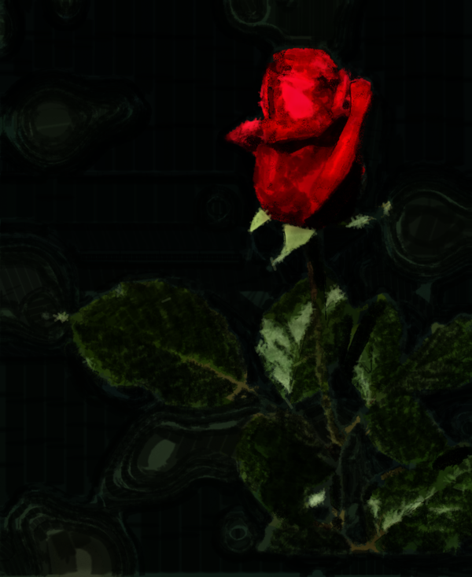
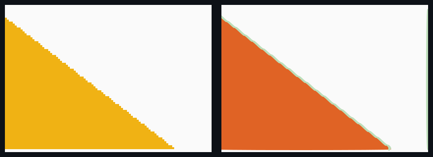
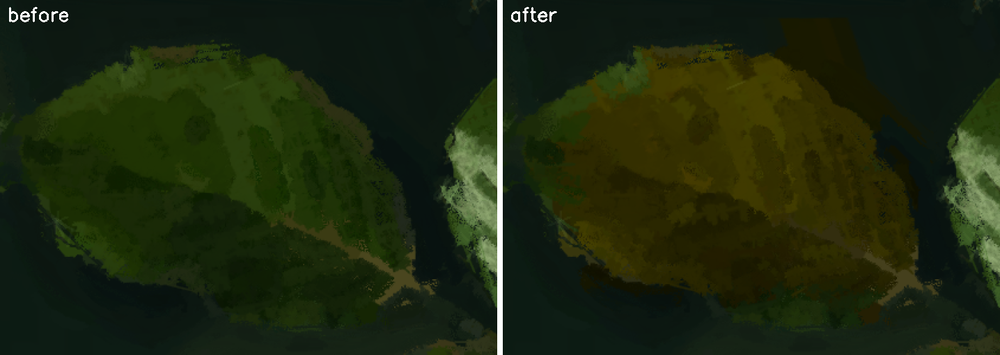
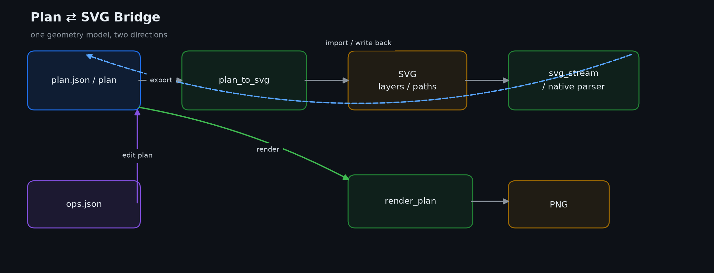

# svg-rebuild-and-paint

**位图 → 真矢量 SVG 重绘（曲线，缩放无台阶）** · **程序化厚涂绘画引擎**（确定性回放 / 增量重绘 / CPU + GPU 双后端） · **计划空间改画**（指令 → 算子 → 像素）

> An asset-agnostic DSH skill repository with three runnable layers: a potrace-based curve SVG
> reconstructor, a deterministic thick-paint rendering engine, and a calibrated ops layer that turns
> instructions into plan edits. Everything below is measured, and every threshold that matters is
> calibrated per project — the skill itself ships **no** tuned values.

[](LICENSE)


<p align="center">
  
  <br>
  <sub>厚涂引擎输出：分层计划、逐笔 stamp 光栅化，确定性回放。</sub>
</p>

<p align="center">
  ▶ <a href="https://github.com/ggfgfgf-on/svg-rebuild-and-paint/releases/download/v1.1.0/svg-rebuild-and-paint-promo-cases.mp4"><b>观看 69 秒案例版</b></a><br>
  ▶ <a href="https://github.com/ggfgfgf-on/svg-rebuild-and-paint/releases/download/v1.1.0/svg-rebuild-and-paint-promo.mp4">观看 2 分 46 秒完整功能演示</a>
</p>

仓库名沿用了历史名称，内容早已不止 SVG。现在它是一个 DSH Skill 仓库，三层都可运行、可验收：

1. **真矢量 SVG 重绘** —— 任意位图（PNG/JPEG，≤2MP）→ potrace 逐色掩码曲线重建（2–3× 超采样）→ 单文件自包含 HTML，纯 `<path>` 平涂几何 + 离散步骤播放器；纯矢量，放大无台阶。
2. **程序化厚涂绘画引擎** —— 场景定义的分层计划（层数/层名由场景决定）→ 笔触光栅化 → 30fps 视频；支持确定性回放、差量/单层/tile 增量重绘、GPU 后端、逐 stamp 上色、PSD/KRA 互操作。
3. **计划空间改画** —— 指令编译成算子（改色/扩缩/细化/局部重画）→ 只重算脏区域；阈值全部来自工程标定，技能只提供机制与辅助函数。

### 关于仓库名

仓库原名为 `generic-pixel-svg-rebuild`，现已更名为 **`svg-rebuild-and-paint`**（内容早已从纯 SVG 扩展到完整绘画引擎）。
GitHub 会自动重定向旧链接：`github.com/ggfgfgf-on/generic-pixel-svg-rebuild` → `github.com/ggfgfgf-on/svg-rebuild-and-paint`。
Skill id 也一并改成了 **`svg-rebuild-and-paint`**（安装目录 `$DSH_HOME/skills/svg-rebuild-and-paint`）。

---

## 效果：三层，各一张图

### 1. 位图 → 真矢量：放大 4× 没有台阶



左：320×200 位图直接按最近邻放大 4×，斜边是阶梯。  
右：同一张图经 `vectorize.py` 重建为纯 `<path>` 曲线，再放大 4×，边界仍是连续曲线。

### 2. 程序化厚涂：计划 → 像素


每根笔触带位置、压力、颜色、硬度和纹理；同一份 plan 重复渲染逐位相同，也支持 GPU、差量和 tile 增量。

### 3. 计划空间改画：改色只重算脏区域



左：原图。右：`ops.json` 编译后的改色结果；几何/背景不动，脏矩形外 0 px 变化。

---

## Plan ⇄ SVG 双向桥

`plan_svg.py` 负责 plan 与 SVG 的双向转换，`plan_svg_native.py` / C++ `plan_svg_core.dll` 负责快速路径。



关键实测（本机，单次测量，非统一测试集）：

| 场景 | 结果 |
|---|---:|
| demo 计划往返 | 1–4 ms |
| 57k 笔 plan → SVG | 0.99 s / 87.7 MB |
| 57k 笔 SVG → plan | 2.16 s |
| 57k 笔文件缓存命中 | 0.95 s |
| 角色图 plan → SVG | 0.25 s / 53.8 MB |
| 角色图 SVG → plan | 1.29 s |

实现要点：

- **曲线不丢**：导入时保存 `path_d` 和按子路径拆分的 `path_d_parts`；未修改的子路径原样输出，只有被改的子路径才退化为折线。
- **精确校验**：`verify_path_d="auto"` 默认对完整几何做哈希，不是抽样；`False` 才按信任模式跳过。
- **大文件快路径**：bridge 输出带 `data-bridge="plan_svg"`，无高级标签时直接走 native；否则走流式/ Python 完整解析。
- **文件缓存**：`load_plan_svg` 用 `path + mtime + size` 缓存二进制 plan，命中后 `unpack` 出新对象；总预算 256MB，LRU 淘汰。
- **不静默丢内容**：`foreignObject` 只支持纯文本子集，遇到 table/img/flex/grid 等会显式 `ValueError`。

边界：完整 CSS 级联、滤镜浏览器栅格化、复杂文本排版、曲线控制点编辑仍是待完善项；详见 `skill/docs/PLAN_SVG.md`。

---

## 能力与实测数字

| 能力 | 实现 | 实测 |
|---|---|---|
| SVG 曲线重绘（默认） | `skill/scripts/vectorize.py`（potrace + 2–3× 超采样） | K=192/2×：193 path、7.36 MB、mean **8.35**、≤5 44.6%；K=384/3×：385 path、19.7 MB、mean **6.36**、≤5 61.0%；验收口径 mean<10、uncovered=0、无台阶 |
| SVG 曲线重绘（vtracer 备选） | `skill/scripts/smooth_svg.py` | 12,034 path / 3.47 MB、mean **7.20**、≤5 65.1%；比 potrace 结果更碎，适合追高保真 |
| 像素游程模式（**已弃用**） | `skill/scripts/build_svg.py` / `autotune.py` | 游程矩形 4133 path / 4.06 MB、mean **2.16**、≤5 96.7%，**放大有像素台阶**；只用于复现旧的 mean<2 数字，不作默认、不作交付 |
| 30fps 视频 | `skill/scripts/render_video.py` + `skill/scripts/planner_8layer.py` | 720 帧 **8.07 s**（进程内）/ 8.76 s 墙钟 |
| 计划级差量重绘 | `skill/scripts/paint_diff.py`（稳定 sid） | 60 行 / 1.4 KB 补丁 → **0.028 s** vs 全量 5.81 s（**209×**，逐位相同） |
| 单层增量 | `skill/scripts/tile_inc.py` | **2.9×**，逐位相同 |
| tile 局部重绘（CPU） | `skill/scripts/tile_inc.rebuild` | 全量 38.45 s → **0.395 s（97×）**，`max_delta = 0` |
| tile 局部重绘（GPU） | `paint_gpu.dll` clear_rect + 区域图 | 2.24 s → **0.314 s（7.1×）**，`max_delta = 0` |
| 多 tile 合并 + 合成缓存 | `skill/scripts/tile_inc` / cache patch | 4 块 / 3,629 笔 **0.985 s**，逐位相同 |
| 逐 stamp 上色（CPU） | `paint_set_color_dynamics` | alpha 逐位不变；同笔 20 种颜色；**+23%** 开销（2.41 → 2.97 s @947×1147×8层） |
| 逐 stamp 上色（GPU） | 打包键 `(alpha16<<16) \| (65535-stampIdx)` | 与 CPU 均值差 **0.001**；关闭时走原路径逐位不变 |
| GPU smudge / impasto | `paint_fx.dll`（DirectCompute） | 1024²：smudge **8.1×**；4096²：impasto **6.8×**；与 CPU 最大差 **1.4e-6**（float32 舍入） |
| 计划空间改画（指令 → 算子） | `skill/scripts/ops.py` / `masks.py` / `compile_ops.py` / `instruction_demo.py` | 909×1100/57,812 笔：编辑 **0.087 s**、局部重算 **0.065 s**（**编辑到出像素 0.15 s**，不含读盘）；增量与整份重画**逐位相同**，脏矩形外 **0 px**；`guidance=0` → 计划逐字节不变 |
| 参数标定（工程级） | `skill/scripts/calibrate.py` / `pick_instance.py` | 13 个判据在样例工程标定；技能包零数值（`test_no_shipped_calibration` 守卫） |
| 标定报告 / 决策表 | `skill/scripts/calib_report.py` / `skill/docs/calib/*.png` | 每个判据一张接触表或分布图；报告由脚本渲染，不手写 |
| 辅助函数 API 文档 | `skill/scripts/api_doc.py` → `skill/docs/API.md` | 从 docstring 生成；三处重复生成结果一致（`test_api_doc_deterministic`） |
| 改色（蓝玫瑰） | `paint_cli edit` + 颜色掩膜 | 2,862 笔红色笔触 → hue 218，背景/叶子零影响；几何掩膜这条路已验证走不通（大笔触横跨花头与背景） |
| 指令编译评测 | `skill/scripts/eval_instructions.py` | 简单集 30 **30/30**；难集（含 10 条应拒绝）v1 **19/20** → 修正版 **20/20**，失败均被 schema 拦住；视觉框选改画区域外 **0 px** |
| 统一入口 | `skill/scripts/paint_cli.py` | `edit` / `compile` / `video` / `eval` 四个子命令；编辑→出图→出视频一条命令（28.4 s 起） |
| 改画 → 30fps 视频 | `skill/scripts/paint_video.py` | 600 帧 / 30 fps / 20.0 s；渲染 54.0 s + 编码 2.53 s = **59.8 s**；末帧与整份重画**逐位相同（0 px）** |
| 笔感扩展 | `skill/scripts/brush_ext.py` | smudge / 浮雕光照 / 纸纹变体 / 色彩动态 / 速度响应 / PSD+KRA 读回 |
| PSD 互操作 | 内置 8BPS 解析器 | 8/16bit、raw+RLE、unicode 图层名、图层组；不依赖 psd-tools |

| **Plan ⇄ SVG 双向桥** | `plan_svg.py` / `plan_to_svg.py` / `svg_to_plan.py` | 逐笔可编辑；软边用 filter 近似；本机基准见 `docs/PLAN_SVG.md`（44,589 笔，单次测量，非统一测试集） |

## 参数标定：值属于工程，技能只给机制

`edge_min_contrast`、`accept_max_area_change`、`model_grow_px`、`ring`、`tol`、`max_spill` 这类阈值没有"通用最优值"。
本仓库的做法是：**脚本枚举候选 / 出接触表 / 量分布，模型看图拍板，值带着证据写进工程目录**，技能里不留任何选好的数字。

| evidence | 什么时候用 | 产物 |
|---|---|---|
| `contact_sheet` | 数值档可枚举 | `skill/docs/calib/<param>.png` |
| `multi_sample` | 阈值型，工程里有 ≥2 份 (图, 描边) | 每样本区间 + 交集 |
| `per_pixel_hist` | 阈值型但只有 1 张图 | 逐边界像素分布图 |
| `measured` | 门限型，先量不同设置下的实际溢出/偏差 | 测量表（如 `spill_measured.json`） |

- 值存在工程目录的 `calibrated.json`；**技能里没有这个文件**（`skill/tests/test_no_shipped_calibration.py` 守卫）。
- 解析顺序：`SVP_CALIBRATED` → 从当前目录向上找 `calibrated.json` → 代码里的**未验证默认值**。
- 来源可查：`pick_instance.CALIBRATED_SOURCE`（`project` / `default`）与 `CALIBRATED_PATH`；用默认值时 `ops.check_calibration()` 推 `kind=uncalibrated` 通知。
- 实测精度同理：`SVP_MEASURED` 指向工程的 `sources_measured.json`；没有就用文档化**范围**，并在 `ops.SOURCES_MEASURED_SOURCE` 里标 `documented`，不许假装是本工程实测。
- 判据没触发不等于调好了：`attach_thin` 返回 `info.inert`（模块级 `LAST_ATTACH`）点名"这次一个块都没筛掉"的判据，对应条目带 `inert_on_sample`。

```powershell
# 数值档：枚举 + 接触表（只写 sweep 与图，不写 value）
python skill/scripts/calibrate.py --param model_grow_px --image <图> --trace <描边.json> --cells <windows.json> --values 0,8,14,20,30

# 阈值/门限：多样本交集或逐像素分布
python skill/scripts/calibrate.py --param edge_min_contrast --samples <工程>\calib.samples.json --json <工程>\calibrated.json

# 记录（必须给证据与理由）
python skill/scripts/calibrate.py --param model_grow_px --choose 20 --evidence contact_sheet --reason "..." --json <工程>\calibrated.json

# 工程样本表、报告、API 文档
python skill/scripts/calibrate.py --make-samples <工程目录> --make-samples-out <工程>\calib.samples.json
python skill/scripts/calib_report.py --json <工程>\calibrated.json --out <工程>\CALIBRATION.md
python skill/scripts/api_doc.py
```

汇总手册（`skill/SKILL.md` 的「参数标定」章）只讲机制与坑，不写任何工程的选值；具体选值与实测留在工程自己的 `CALIBRATION.md`。

## SVG 重绘的验收口径（两个目标互斥，必须写清）

旧文档同时要求「游程像素」与「曲线」并要求 `mean < 2`、`100% ≤ 10`。这两件事**不可能同时成立**：

- 像素级精确复现**必须**用轴对齐整数游程——台阶本身就是编码方式，不是缺陷；平涂源能到 mean 0.43，AA 立绘 2.16。
- 任何曲线拟合在抗锯齿源上必然偏离 2/255 以上：`vectorize.py` 的实测区间是 **mean 3.74 … 8.35**。

因此交付口径按分支区分：**默认 `vectorize.py`，预算 mean < 10、uncovered = 0、无台阶；像素分支已弃用**，只保留复现历史数字的能力（`build_svg.py` 运行会直接打印 `DEPRECATED`）。

## 确定性契约

三条硬约束，全部由测试守住：

1. **同计划 → 逐位相同的像素**（同后端重复渲染 `max_delta = 0`）。
2. **增量结果 == 全量重画**（diff / 单层 / tile / 多 tile / 缓存补片，全部 `np.array_equal`）。
3. **CPU 与 GPU 视觉等价**：单笔边缘 1 像素差异是已知且有记录的，不做"魔法常数"式对齐。

## 快速开始

```powershell
# Windows：自动装进"DSH 实际在用的 home"（$env:DSH_HOME，其次脚本所在的 .dsh/.dsh-home，
# 其次 ~/.dsh），装完跑一次 selfcheck；旧版本落在 <home>\skill-backups（不在 skills 里）
git clone https://github.com/ggfgfgf-on/svg-rebuild-and-paint.git
.\svg-rebuild-and-paint\skill\install.ps1

# 明确指定 home / skills 根目录
.\svg-rebuild-and-paint\skill\install.ps1 -HarnessHome D:\x\.dsh
.\svg-rebuild-and-paint\skill\install.ps1 -Dest D:\x\skills

# macOS / Linux（绘画半区需要 Windows x64 的 DLL）
./svg-rebuild-and-paint/skill/install.sh
```

快速开始与命令以安装包内的 [skill/README.md](skill/README.md) 为唯一来源；这里不重复维护，避免根 README 与 skill README 漂移。

入口手册：`skill/SKILL.md`；辅助函数签名（自动生成）：`skill/docs/API.md`；Plan ⇄ SVG：`skill/docs/PLAN_SVG.md`；设计与测量：`skill/IMPLEMENTATION.md`。

## 测试

`skill/tests/` 下有 **60 个测试脚本**。SVG 与绘画侧的历史套件继续以"逐位相同"为判定；本轮新增的标定与文档套件是：

```powershell
python skill/tests/test_calibrated.py            # 工程标定解析 / 来源标记
python skill/tests/test_calibrated_types.py      # 非法值拒绝（bool / 字符串数字 / 列表）
python skill/tests/test_calibrate_multi.py       # 多样本交集与判据
python skill/tests/test_no_shipped_calibration.py  # 技能不许自带标定值（不是任意 cwd 都成立）
python skill/tests/test_calib_report.py          # 工程 CALIBRATION.md 渲染
python skill/tests/test_api_doc.py               # docs/API.md 覆盖与签名
python skill/tests/test_api_doc_deterministic.py # 换 cwd / 环境变量，生成结果必须一致
python skill/tests/test_pick_instance.py         # 辅助函数（zoom_plan / attach_thin / filter_added / edge_report）
python skill/tests/test_zoom_plan.py             # ROI 切窗与单元格预算
python skill/tests/test_inert_exposure.py        # 未触发判据必须被点名
python skill/tests/test_spill_gate.py            # 溢出估算只通知、不阻断
python skill/tests/test_tol_project.py           # tol 属工程级，不随技能下发
python skill/tests/test_sources.py               # 精度来源 project / documented
python skill/tests/test_ops.py / test_ops_instance.py / test_loop_components.py
```

`test_no_shipped_calibration.py` 以前用"技能目录"当空目录，一旦技能被装进某个工程就会读到工程的 `calibrated.json`（实测误读 `model_grow_px=20` 并失败）。现在固定在一个临时空目录里跑。

## 目录结构

```
skill/SKILL.md                  # 入口手册（含局部改画 / 标定 / 逐 stamp 色彩 / GPU fx 章节）
skill/docs/API.md               # 辅助函数与选择源语义（由 scripts/api_doc.py 生成，勿手改）
skill/docs/calib/*.png         # 各判据的接触表 / 分布图（标定证据）
skill/IMPLEMENTATION.md        # 设计与测量记录
skill/AUDIT.md                 # 能力审计（哪些有、哪些没有）
skill/scripts/
  vectorize.py ...                           # SVG 重绘线
  planner_8layer.py plan_store.py paint_diff.py tile_inc.py   # 绘画线
  paint_native.py paint_gpu_native.py paint_fx_native.py      # 三个原生后端绑定
  ops.py masks.py compile_ops.py             # 计划空间改画
  pick_instance.py calibrate.py calib_report.py api_doc.py    # 标定 / 报告 / 文档
  brush_ext.py                               # 笔感扩展（CPU 参考实现）
  native/                                    # C++ 源码 + 预编译 DLL + build.ps1
skill/tests/                    # 48 个测试文件
pixel-svg-reconstruction-generic.md   # 原始方法论文档
```

## 构建原生库

```powershell
powershell -ExecutionPolicy Bypass -File skill/scripts/native/build.ps1 -Gpu
```

源码含中文注释，**必须带 `/utf-8`**；否则 MSVC 按系统代码页解析会报一堆假语法错误（`C2530`、`C2065` 之类）。脚本已经带上，支持 MSVC BuildTools。

## 已知边界（不掩饰）

- **技能不含任何标定值**：直接用默认值时判据是"未验证"的，`ops` 会推 `uncalibrated` 通知；要可用必须先在自己的工程里标定。
- 判据可能"没触发"：`attach_width` / `attach_len` / `attach_hue` 在样本上一个块都没筛掉时会被 `info.inert` 点名——此时"扫了没差别"不等于"调好了"。
- `attach_px` 只在给了 `near` 时生效；`refine` 只精修、不重新分割，种子太粗时阶梯仍在。
- `masks.spill()` 是面积估算（笔数 × 样本数 × 笔宽），`ops.check_spill()` 只发通知、从不报错；样例工程实测 any 模式 24.5% / center 0.46% / all 0%。
- CPU 与 GPU 在笔触边缘有 1 像素差异（alpha profile 7 行 vs 6 行），视觉等价但**不是**逐位相同；不做常数对齐。
- GPU 逐 stamp 上色开启时 alpha 走 16bit 量化（8bit 输出上看不出，alpha 最大差 0），关闭时逐位不变。
- smudge / impasto 是后处理 pass，不参与笔触内核；它们在 GPU 上很快，但语义仍是"画完再处理"。
- 没有任何与第三方工具的正面基准对比记录。

## License

GPL-2.0-or-later。tracing 核心是 potrace（编译版 `trace_core.dll` 与纯 Python `potracer` 回退），详见 `skill/NOTICE`；`vtracer`（smooth 模式）是 MIT，不进入 GPL 路径。
笔尖贴图（278 张 128×128 PNG，源自古开源笔刷包的 Krita `.kpp` / GIMP `.gbr/.gih`）来源与许可见 `skill/scripts/native/tips/PROVENANCE.md`，逐条 `src` 记录在 `index.json`。
